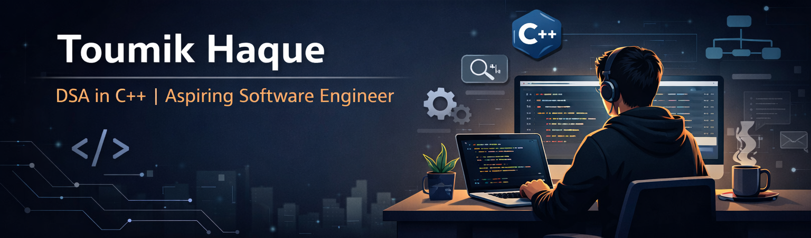

 

# Hi, I'm Toumik Haque 👋

### Full-Stack Developer · CSE Undergraduate · Software Engineering Enthusiast

I build practical web applications and enjoy turning ideas into useful digital products.

---

## 👨‍💻 About Me

- 🎓 Third-year **B.Tech Computer Science & Engineering** student at **Alipurduar Government Engineering and Management College (AGEMC)**, affiliated with MAKAUT.
- 💻 Interested in full-stack web development and software engineering.
- 🌱 Practising **Data Structures & Algorithms in C++** while strengthening my development skills.
- 🤝 Enjoy collaborating on projects, learning from other developers, and contributing to team-based work.
- 🎯 Working towards becoming a well-rounded software engineer.

## 🧰 Tech Stack

## 🚀 Featured Projects

<table>
<tr>
<td width="33%" valign="top">

<h3 align="center">🌐 CodeSphere</h3>

A platform for developer communities and project collaboration.

<a href="https://github.com/Toumik-Haque/CodeSphere">
<b>Explore Project →</b>
</a>

</td>

<td width="33%" valign="top">

<h3 align="center">🎓 EduAdapt</h3>

An adaptive education ecosystem for personalised learning.

<a href="https://github.com/Toumik-Haque/EduAdapt">
<b>Explore Project →</b>
</a>

</td>

<td width="33%" valign="top">

<h3 align="center">🏠 HostelLog</h3>

Digital hostel & mess management system with attendance and administration features.

<a href="https://github.com/Toumik-Haque/hostelLog">
<b>Explore Project →</b>
</a>

</td>
</tr>
</table>

[Explore All My Repositories →](https://github.com/Toumik-Haque?tab=repositories)

## 💼 Experience

**React Development Intern — WebDzen Technologies**  
*July 2025 – September 2025*

- Worked with a team on the frontend of a Learning Management System.
- Contributed to dashboard interfaces and course-related user experiences.
- Strengthened practical skills in React and collaborative development.

## 📊 GitHub Overview

### 🔥 Contribution Streak

### 📈 Contribution Activity

## 🎯 Currently Focusing On

- Solving DSA problems using **C++**.
- Building and improving full-stack web applications.
- Strengthening JavaScript, React, Node.js, and database fundamentals.
- Learning software engineering practices through collaborative projects.

## 🤝 Let's Connect

I'm open to learning opportunities, collaboration, and meaningful conversations around software development.

- **Portfolio:** https://toumik.vercel.app
- **LinkedIn:** https://www.linkedin.com/in/toumik/
- **GitHub:** https://github.com/Toumik-Haque

---

*“Learn continuously. Build consistently. Improve every day.”*

